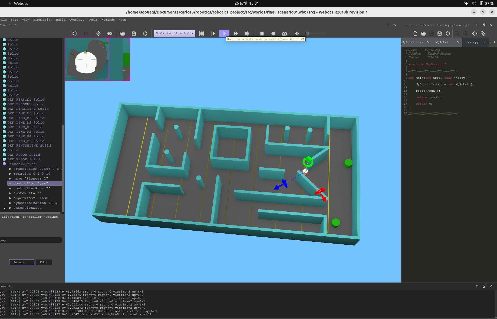

# 🤖 Robot de sauvetage autonome — Webots / Pioneer II

Contrôleur en **C++** pour un robot Pioneer II qui explore une zone sinistrée simulée, détecte deux victimes à la caméra et revient à son point de départ, le tout en moins de 4 minutes.

> Projet final du cours *Robotics*, **Universidad Carlos III de Madrid** (échange Erasmus, 2026)
> Binôme : **Selma Douagi** & Elizabeth Faulkner



---

## 🎯 Le défi

- Une salle de 10 × 20 m, avec **10 variantes de scénario** : obstacles différents, brouillard, éclairage variable.
- Le scénario de la compétition est **tiré au sort**, ainsi que la position et l'orientation de départ du robot.
- Le robot doit traverser la salle en évitant murs et obstacles, puis trouver **2 victimes** (cylindres verts) : s'arrêter à moins d'1 m de chacune et faire un tour sur lui-même.
- Il doit ensuite **revenir à la ligne de départ**.
- Les capteurs et actionneurs sont **bruités**, et le GPS a une résolution de 3 m : il ne sert qu'à recaler l'odométrie.

## 🧠 Approche : une machine à états en 5 phases

| Phase | Ce que fait le robot |
|---|---|
| **1. Orientation** | S'aligne sur l'axe de la salle grâce à la boussole |
| **2. Identification du monde** | Mesure la luminosité à la caméra (sombre, brouillard ou lumineux), puis va mesurer la distance aux murs à droite et à gauche et sonde les obstacles devant lui. Ces mesures lui permettent de **reconnaître lequel des 10 scénarios** il affronte. |
| **3. Navigation** | Suit un chemin de *waypoints* propre au scénario reconnu, avec un régulateur proportionnel sur le cap et de l'évitement d'obstacles |
| **4. Détection des victimes** | Analyse les pixels de la caméra avant (vert dominant sur le rouge et le bleu, au-dessus d'un seuil de ratio), s'approche à moins d'1 m puis fait un tour à 360° |
| **5. Retour** | Navigue jusqu'à la ligne de départ |

**Capteurs utilisés :** 16 capteurs de distance, boussole, encodeurs de roues (odométrie), GPS (recalage uniquement), caméra avant et caméra sphérique.

## 📁 Structure

```
src/
├── controllers/
│   ├── group4/          # Contrôleur avec identification complète du monde (MyRobot.h / .cpp)
│   └── deuxieme_meth/   # Variante : identification + chemin prédéfini, retour par le chemin inverse
├── worlds/              # Les 10 scénarios de test (final_scenario01..10.wbt)
└── protos/              # Modèle du Pioneer II
docs/
└── ANALYSIS.md          # Analyse du code et pistes de refactorisation
```

## ▶️ Lancer la simulation

1. Installer [Webots](https://cyberbotics.com/) (le projet a été développé sous R2019b).
2. Ouvrir `src/worlds/final_scenario01.wbt` (ou n'importe quel autre scénario).
3. Webots compile le contrôleur automatiquement. Pour compiler à la main, lancer `make` dans `src/controllers/group4/`.

## 🛠️ Technologies

`C++` · `Webots` · machine à états · odométrie · régulation proportionnelle · traitement d'image (segmentation couleur)
